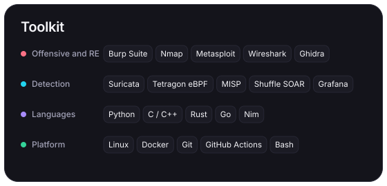

<a href="https://github.com/AtokTajuddin?tab=repositories"><picture><source media="(prefers-color-scheme: dark)" srcset="assets/hero-dark.svg" /><source media="(prefers-color-scheme: light)" srcset="assets/hero-light.svg" /></picture></a><a href="https://profile.hackthebox.com/profile/019cfed2-60ce-730f-a565-c66876cfda10"><picture><source media="(prefers-color-scheme: dark)" srcset="assets/htb-dark.svg" /><source media="(prefers-color-scheme: light)" srcset="assets/htb-light.svg" /></picture></a>
<a href="https://tryhackme.com/p/Hadamard"><picture><source media="(prefers-color-scheme: dark)" srcset="assets/thm-dark.svg" /><source media="(prefers-color-scheme: light)" srcset="assets/thm-light.svg" /></picture></a><a href="https://github.com/AtokTajuddin/big_architectiure_soc_project"><picture><source media="(prefers-color-scheme: dark)" srcset="assets/nexus-dark.svg" /><source media="(prefers-color-scheme: light)" srcset="assets/nexus-light.svg" /></picture></a>
<a href="https://github.com/AtokTajuddin/BOAR_Project"><picture><source media="(prefers-color-scheme: dark)" srcset="assets/boar-dark.svg" /><source media="(prefers-color-scheme: light)" srcset="assets/boar-light.svg" /></picture></a><a href="https://github.com/AtokTajuddin/nim-pe-analyzer"><picture><source media="(prefers-color-scheme: dark)" srcset="assets/pe-dark.svg" /><source media="(prefers-color-scheme: light)" srcset="assets/pe-light.svg" /></picture></a>
<picture><source media="(prefers-color-scheme: dark)" srcset="assets/toolkit-dark.svg" /><source media="(prefers-color-scheme: light)" srcset="assets/toolkit-light.svg" /></picture><picture><source media="(prefers-color-scheme: dark)" srcset="assets/langs-dark.svg" /><source media="(prefers-color-scheme: light)" srcset="assets/langs-light.svg" /></picture>
<picture><source media="(prefers-color-scheme: dark)" srcset="assets/activity-dark.svg" /><source media="(prefers-color-scheme: light)" srcset="assets/activity-light.svg" /></picture><picture><source media="(prefers-color-scheme: dark)" srcset="assets/trophies-dark.svg" /><source media="(prefers-color-scheme: light)" srcset="assets/trophies-light.svg" /></picture>

<picture><source media="(prefers-color-scheme: dark)" srcset="https://raw.githubusercontent.com/AtokTajuddin/AtokTajuddin/output/github-snake-dark.svg" /><source media="(prefers-color-scheme: light)" srcset="https://raw.githubusercontent.com/AtokTajuddin/AtokTajuddin/output/github-snake.svg" /></picture>

I study Information Technology at Institut Teknologi Sepuluh Nopember (ITS) in Surabaya. Most of my practice happens on Hack The Box and TryHackMe: web exploitation, then privilege escalation on Linux and Windows. Alongside it I write analysis tools in Python, C++ and Nim, and run a SOC lab for the defensive side.

Interested in collaborating on security research, CTFs, and open source security tooling.
